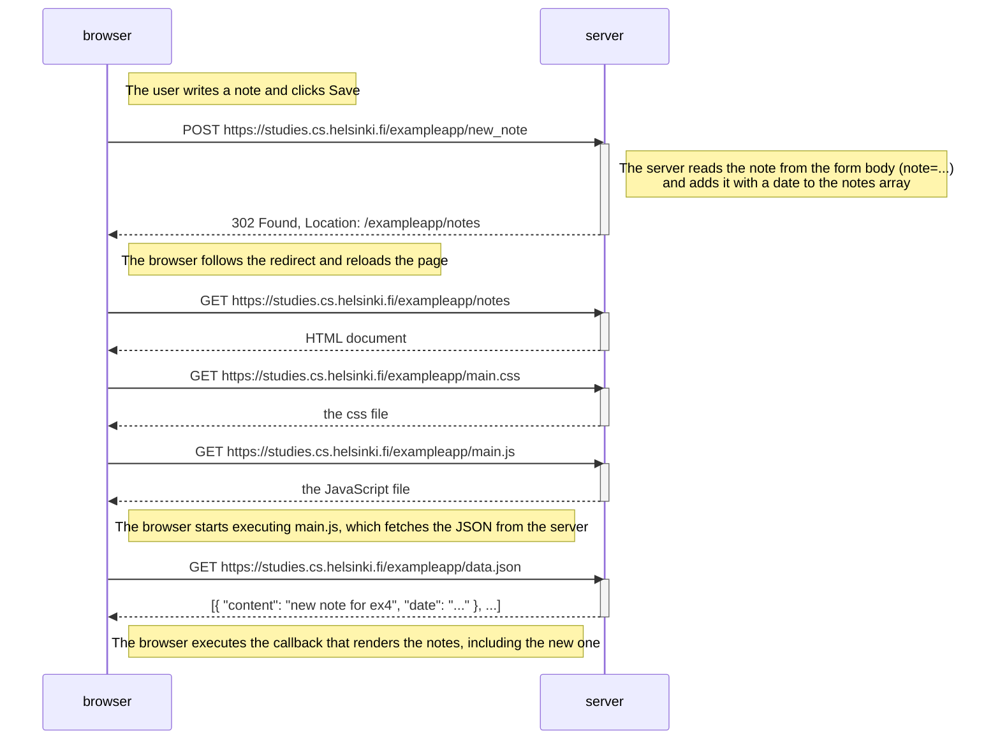
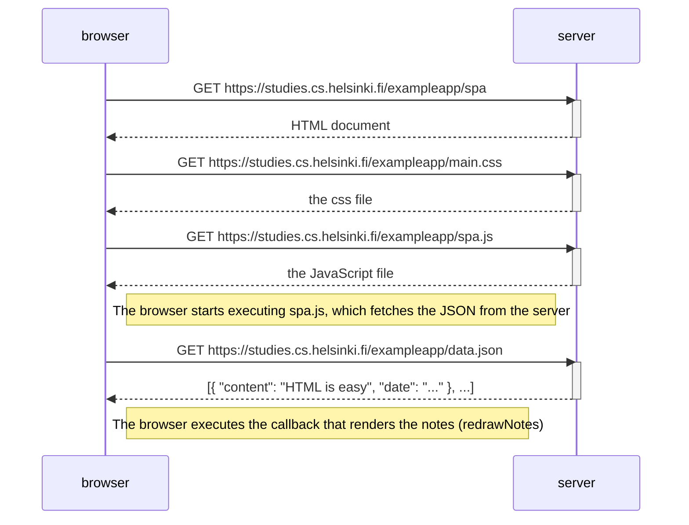
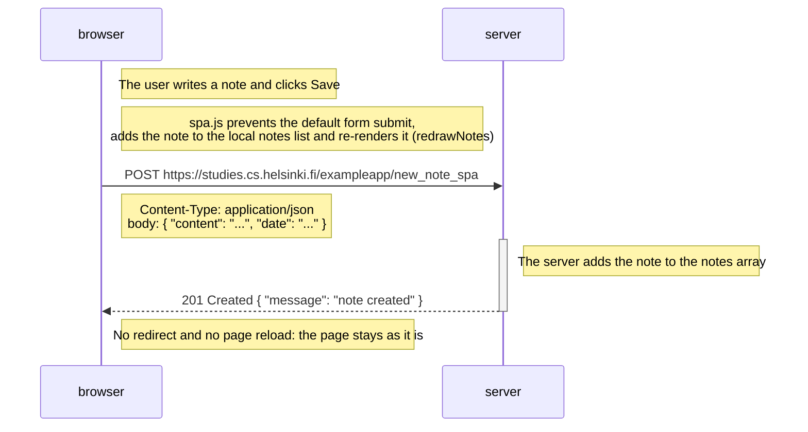

# Part 0 — Fundamentals of Web apps

## 0.1–0.3 (reading only, not submitted)

- [ ] 0.1 [HTML basics](https://developer.mozilla.org/en-US/docs/Learn/Getting_started_with_the_web/HTML_basics)
- [ ] 0.2 [CSS basics](https://developer.mozilla.org/en-US/docs/Learn/Getting_started_with_the_web/CSS_basics)
- [ ] 0.3 [Your first form](https://developer.mozilla.org/en-US/docs/Learn/HTML/Forms/Your_first_HTML_form)

## 0.4 New note diagram

Page: https://studies.cs.helsinki.fi/exampleapp/notes — the user writes a note and clicks Save.

## 0.5 Single page app diagram

Page: https://studies.cs.helsinki.fi/exampleapp/spa — the user opens the page.

## 0.6 New note in Single page app diagram

Page: https://studies.cs.helsinki.fi/exampleapp/spa — the user creates a new note.

